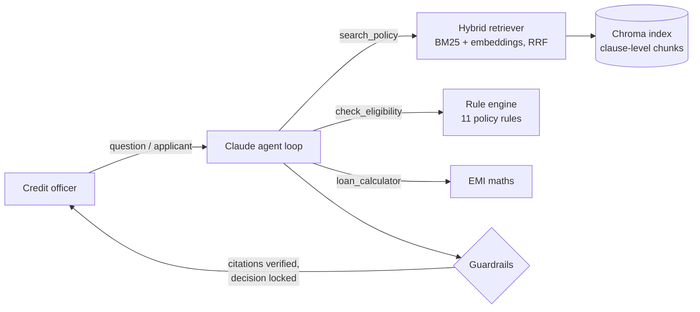

# Agentic Lending Policy & Underwriting Assistant

A credit-officer assistant built on a Claude tool-calling agent. It answers lending-policy questions with cited clauses from a hybrid RAG index, and assesses applicants through a deterministic underwriting rule engine. The LLM plans, retrieves, explains and drafts credit memos. It never makes the credit decision itself.



## What it does

| Capability | How |
| --- | --- |
| **Agentic Q&A** | A tool-use loop on the Claude Messages API. The model decides which tools to call, reformulates searches when the first results are weak, breaks multi-part questions into several searches and calls tools in parallel. The loop stops after a set number of steps. |
| **Grounded, verifiable answers** | Every policy fact is cited as `[§x.y]`. After each run, each citation is checked against the clauses the tools actually returned, so a made-up citation is flagged in the UI and counted in evals. |
| **Deterministic decisions** | `check_eligibility` evaluates all 11 rules in the policy: age at application and at maturity, salaried vs self-employed income, FOIR including the new EMI, product amount and tenure limits, tiered housing LTV, business collateral, CIBIL by product, hard inquiries, 30+ DPD, and prohibited industries. Every rule cites the clause it implements. |
| **Counter-offers** | The engine computes the largest loan the applicant qualifies for (limited by FOIR headroom, the product cap and LTV). The agent uses it to suggest an amount that can be approved. |
| **AI credit memo** | Builds a structured memo from the engine's output. A guardrail makes sure the memo states the engine's decision. |
| **Hybrid retrieval** | BM25 handles exact terms (CIBIL, LTV, DPD). Dense MiniLM embeddings handle paraphrases ("borrow against my house"). The two rankings are merged with Reciprocal Rank Fusion. If the embedding model is unavailable, it falls back to BM25 only. |
| **Structure-aware chunking** | Each policy bullet becomes one chunk with its section and a stable id (`retail_lending_guidelines §2.2`). Rules are never cut in half. Rebuilding the index is idempotent. `.txt`, `.md` and `.pdf` files are supported. |
| **Observability** | The UI shows the agent trace: each tool call with its arguments, result and latency, plus token usage per answer. |
| **Evaluation** | Includes a labelled golden set, retrieval metrics (hit@1, recall@k, MRR for BM25, dense and hybrid), and agent metrics: answer accuracy, citation grounding, tool selection, decision accuracy, and LLM-as-judge faithfulness. |
| **Works without an API key** | Retrieval, the rule engine and the UI all run without a key. Only generated answers and memos need Claude. |

## Quick start

```bash
git clone https://github.com/yash9518/lending-policy-rag.git
cd lending-policy-rag
python -m venv .venv && source .venv/bin/activate   # Windows: .venv\Scripts\Activate.ps1
pip install -r requirements.txt
python -m src.ingest            # optional: the app builds the index on first start
streamlit run app.py
```

To enable the agent, create a `.env` file (it is git-ignored):

```bash
ANTHROPIC_API_KEY=your-key-here
LLM_MODEL=claude-haiku-5-5      # default; claude-sonnet-5-5 gives stronger multi-step reasoning
```

The app has three tabs:

1. **Ask the agent**: chat about the policy, or describe an applicant in plain English. Expand *Agent trace* to see each tool call.
2. **Underwrite an applicant**: a full applicant form with a live rule-by-rule decision, EMI, FOIR and max eligible amount, plus **Generate AI credit memo**.
3. **Retrieval inspector**: compare BM25, dense and hybrid rankings for any query.

## Tests and evaluation

```bash
pytest                                    # 32 offline tests: rules, chunking, retrieval, agent loop (fake LLM client)
python -m evaluation.run_eval             # retrieval metrics, no API key needed
python -m evaluation.run_eval --agent --judge   # end-to-end agent metrics + LLM-as-judge
```

The agent-loop tests use a scripted fake client. They check tool dispatch, parallel tool results returned in a single turn, error recovery from bad tool arguments, the step limit, flagging of made-up citations, and the decision lock on memos.

Current retrieval baseline, BM25 only, on 14 labelled questions: hit@1 0.79, recall@4 1.00, MRR 0.88. Run the eval with embeddings enabled to compare dense and hybrid.

## Project layout

| Path | Purpose |
| --- | --- |
| `app.py` | Streamlit UI |
| `src/agent.py` | Agent loop, system prompts, citation verification, credit memo |
| `src/tools.py` | Tool schemas and executor (`search_policy`, `check_eligibility`, `loan_calculator`) |
| `src/rules.py` | Underwriting rule engine, EMI / FOIR / LTV maths, max eligible amount |
| `src/retriever.py` | Hybrid BM25 + dense retriever with RRF |
| `src/ingest.py` | Structure-aware chunking and Chroma indexing |
| `src/llm.py`, `src/config.py` | Claude client and settings (env-overridable) |
| `evaluation/` | Golden set and eval runner |
| `tests/` | Pytest suite |

## Design decisions

- **The LLM explains, code decides.** Credit decisions must be reproducible and auditable, so approve/decline comes from rules in code. The agent's job is routing, retrieval and explanation. The memo cannot change the decision.
- **Citations are verified, not trusted.** The model's citations are checked against what was actually retrieved in that run. This catches the most common RAG failure: a confident answer with a made-up source.
- **Rules live in code, not in the documents.** Thresholds in `src/rules.py` mirror Credit Policy v4.2. Editing the policy text updates retrieval but not the engine, so update `POLICY` in `rules.py` when the policy changes.

## Deploying (Streamlit Community Cloud)

Push the repo, create an app with `app.py` as the entry point, and add `ANTHROPIC_API_KEY` (and optionally `LLM_MODEL`) under **Secrets**. On first boot the index is built automatically. `sentence-transformers` pulls in PyTorch, so small hosts may run out of memory. In that case the app still runs in BM25-only mode, or you can use a host with more RAM.
