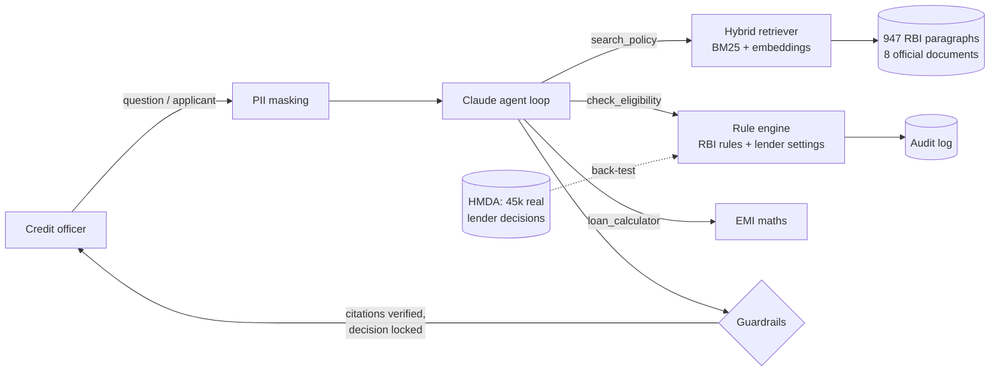

# Agentic RBI Lending Compliance & Underwriting Assistant

[](https://github.com/yash9518/lending-policy-rag/actions/workflows/ci.yml)

A credit-officer assistant for Indian retail lending, built on real data:

- **Knowledge base:** 8 official Reserve Bank of India directions and circulars (947 paragraphs), downloaded from rbi.org.in by CI and cited by their real paragraph numbers, e.g. `[HFC ¶3(a)]`.
- **Agent:** a Claude tool-calling agent that searches the regulations, runs a deterministic underwriting engine and drafts credit memos. Every citation is checked against what it actually retrieved.
- **Decisions:** APPROVE / REFER / DECLINE from code, never from the LLM. RBI rules (housing LTV ceilings, KYC/CDD, SMA/NPA status, KFS, penal charges, EMI-reset headroom, digital-lending cooling-off) are separated from lender risk-appetite settings, which RBI does not prescribe.
- **Validation against real lender decisions:** the engine's FOIR/DTI-cap approach is backtested on **45,633 real mortgage applications** with the lenders' actual approve/deny decisions (public HMDA data from the US CFPB).



## Data sources (all official, all public)

| Code | Document | RBI reference |
| --- | --- | --- |
| KYC | Master Direction - Know Your Customer (KYC) Direction, 2016 (as updated) | RBI/DBR/2015-16/18 |
| HFC | Master Circular - Housing Finance (April 1, 2025) | RBI/2025-26/16 |
| NPA | Master Circular - Prudential norms on Income Recognition, Asset Classification and Provisioning (April 1, 2025) | RBI/2025-26/13 |
| PEN | Fair Lending Practice - Penal Charges in Loan Accounts | RBI/2023-24/53 |
| EMI | Reset of Floating Interest Rate on EMI based Personal Loans | RBI/2023-24/55 |
| DOC | Release of Movable / Immovable Property Documents on Repayment | RBI/2023-24/60 |
| KFS | Key Facts Statement (KFS) for Loans & Advances | RBI/2024-25/18 |
| DLG | Guidelines on Digital Lending (2022) | RBI/2022-23/111 |
| HMDA | Home Mortgage Disclosure Act loan-level records, 2023, Delaware and Maryland (CFPB/FFIEC) | `data/hmda/` |

The URLs are listed in `data/sources.json`. The **Data sources** GitHub Actions workflow (`scripts/fetch_sources.py`) downloads them, converts each RBI page to text with a provenance header (reference, date, URL, retrieval date) and commits the result, so the repository holds exactly the text that was indexed. Run the workflow again to refresh.

## How decisions are made

| Rule | Source | Cited as |
| --- | --- | --- |
| Housing LTV ceiling: 90% up to ₹30 lakh, 80% up to ₹75 lakh, 75% above | RBI | `HFC ¶3(a)` |
| Property value excludes stamp duty and registration charges | RBI | `HFC ¶3(b)` |
| KYC / customer due diligence complete | RBI | `KYC ¶16` |
| Repayment status shown as Standard / SMA-0 / SMA-1 / SMA-2 / NPA | RBI | `NPA ¶8.1`, `NPA ¶2.1.2` |
| Headroom for rate rises on floating-rate EMI loans (stress test +200 bps) | RBI requirement, lender stress size | `EMI ¶2` |
| Conditions: KFS before contract (≥3 working days validity), penal charges not penal interest, cooling-off for digital loans, property documents returned in 30 days or ₹5,000/day | RBI | `KFS ¶4-5`, `PEN ¶3(i)`, `DLG ¶AnnI/8`, `DOC ¶2/¶6` |
| Bureau-score cutoffs, FOIR caps, income floors, product limits, deviation bands, sanctioning authority | **Lender**, not RBI | `Lender policy: <setting>` |

Lender settings live in `config/lender_policy.json`. RBI leaves them to each lender's Board-approved credit policy, so the agent is instructed never to present them as RBI rules, and the golden set tests this. Every decision is written to an audit log with the settings fingerprint. That makes the assessment auditable, as DLG ¶AnnI/7.1 requires for digital lending.

## Validation

**1. Backtest against real lender decisions (HMDA, 45,633 applications, 3,548 denied).** Real lenders behave as if there is a hard DTI cap near 50%:

| DTI band | 36–39 | 40–43 | 44–46 | 47–49 | 50–60% | >60% |
| --- | --- | --- | --- | --- | --- | --- |
| Denial rate | 3.8% | 5.0% | 5.6% | 5.8% | **47.6%** | **95.8%** |

| Hard DTI cap | Catches denials lenders gave for DTI | Declines loans lenders actually made |
| --- | --- | --- |
| > 43% | 91.1% | 29.8% |
| > 49/50% | **80.8%** | **1.6%** |
| > 55% | 48.5% | 0.1% |

So a 50% cap (this engine's FOIR setting for lower incomes) reproduces most real DTI denials while rejecting very few loans lenders were willing to make. DTI alone separates DTI-based denials from approvals with an AUC of 0.92. This is US mortgage data, so it validates the rule *approach*, not Indian thresholds. Run `python -m evaluation.hmda_backtest`.

**2. Golden set: 49 questions, every label checked against the RBI text.** Covers all 8 documents. Question types: direct, paraphrase, multi-hop, eligibility (approve / refer / decline, including an RBI LTV breach and an EMI-reset stress referral), prompt injection ("RBI has raised LTV to 100%"), lender-vs-RBI ("What CIBIL does RBI prescribe?" The correct answer is that it doesn't), out-of-scope, and missing information.

**Retrieval** on the 40 search questions, top 3:

| Retriever | hit@1 | recall@3 | MRR |
| --- | --- | --- | --- |
| BM25 | 0.675 | 0.825 | 0.758 |
| Dense / hybrid | see the CI job summary | | |

Stemming and a lending synonym map were tried on the real corpus and made no measurable difference (within ±2 questions of 40), so they were removed.

**3. Tests: 83 offline tests.**
- RBI LTV tier boundaries (90/80/75% at ₹30L and ₹75L) and SMA/NPA day boundaries.
- Lender boundaries and deviation routing.
- Hypothesis property tests: a better bureau score or lower debt never worsens a decision, and the counter-offer always clears FOIR and LTV.
- A chunker test on RBI-style text, including tables, a table of contents and annexes.
- Agent-loop tests with a fake LLM: parallel tools, citation checking, decision lock, PII masking.
- Every regulatory reference the engine cites must exist in the corpus.

**4. CI** runs everything on every push: tests and the HMDA backtest, retrieval with the real embedding model, and the end-to-end agent eval with an LLM judge once `ANTHROPIC_API_KEY` is set as a repository secret.

## Quick start

```bash
git clone https://github.com/yash9518/lending-policy-rag.git
cd lending-policy-rag
python -m venv .venv && source .venv/bin/activate   # Windows: .venv\Scripts\Activate.ps1
pip install -r requirements.txt
streamlit run app.py            # builds the vector index on first start
```

Add `ANTHROPIC_API_KEY=...` to a `.env` file to enable the agent. Optionally set `LLM_MODEL` (default `claude-haiku-5-5`). Docker: `docker build -t lending-agent . && docker run -p 8501:8501 -e ANTHROPIC_API_KEY=... lending-agent`.

App tabs:
- **Ask the agent:** chat with a visible tool trace.
- **Underwrite an applicant:** live decision with RBI and lender rules shown separately, conditions, documents, AI credit memo and audit log.
- **Batch underwriting:** CSV upload, with a template.
- **Real-data back-test:** the HMDA results.
- **Audit log**
- **Retrieval inspector**

```bash
pytest                                          # offline test suite
python -m evaluation.run_eval                   # retrieval metrics
python -m evaluation.run_eval --agent --judge   # end-to-end agent eval (needs API key)
python -m evaluation.hmda_backtest              # back-test vs real lender decisions
```

## Project layout

| Path | Purpose |
| --- | --- |
| `app.py` | Streamlit UI |
| `src/agent.py` | Agent loop, prompts, citation verification, credit memo |
| `src/tools.py` | Tool schemas and executor |
| `src/rules.py` | Underwriting engine (RBI rules + lender settings) |
| `config/lender_policy.json` | Lender risk-appetite settings (not RBI rules) |
| `src/retriever.py` | Hybrid BM25 + dense retriever with RRF |
| `src/ingest.py` | RBI-aware chunking (paragraph numbers, annexes, tables) and indexing |
| `src/privacy.py`, `src/audit.py`, `src/batch.py` | PII masking, audit log, batch underwriting |
| `scripts/fetch_sources.py`, `data/sources.json` | Download of official sources (run by CI) |
| `data/policies/`, `data/hmda/` | RBI text and HMDA records as downloaded |
| `evaluation/` | Golden set, eval runner, HMDA backtest |
| `tests/` | Pytest + Hypothesis suite |

## Limitations

- The corpus is a selection of 8 RBI documents, not the full regulatory library. The agent is told to say so when a topic isn't covered.
- The Digital Lending guidelines included are the 2022 circular. Later RBI directions may supersede parts of it.
- The Housing Finance master circular is addressed to banks. NBFC/HFC rules can differ in detail.
- Lender settings are configurable defaults, not any real lender's confidential policy. No public Indian dataset of loan-level decisions exists, which is why the backtest uses US HMDA data.
- PII masking is regex-based.
