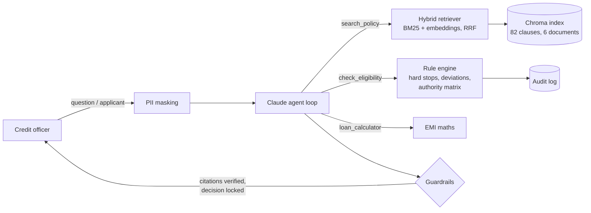

# Agentic Lending Policy & Underwriting Assistant

[](https://github.com/yash9518/lending-policy-rag/actions/workflows/ci.yml)

A credit-officer assistant for retail lending. A Claude tool-calling agent answers policy questions with verified clause citations from a hybrid RAG index over six policy documents. Applicants are assessed by a deterministic underwriting engine that returns **APPROVE / REFER / DECLINE** with the sanctioning authority, conditions and required documents. The LLM plans, retrieves, explains and drafts credit memos. It never makes the credit decision.

> The lender ("Meridian Retail Finance") and its policies are fictional. They are modelled on common Indian retail-lending practice (FOIR, LTV tiers, CIBIL, KYC/CKYCR, KFS, SMA/NPA, Integrated Ombudsman) for demonstration only.



## What it does

| Capability | How |
| --- | --- |
| **Agentic Q&A** | A tool-use loop on the Claude Messages API. The model chooses tools, rewords weak searches, splits multi-part questions and calls tools in parallel. The loop is bounded: on the last step, tools are disabled so the model has to answer. |
| **Verified citations** | Answers cite clauses as `[RLG §2.2]`. Every citation is checked against the clauses the tools returned in that run. Made-up citations are flagged in the UI and counted in evals. |
| **Realistic credit decisions** | Hard stops (age, 30+ DPD, write-off/settlement, prohibited industry, KYC, product limits, LTV, collateral) lead to **DECLINE**. Soft rules (bureau score, FOIR, inquiries, income) have deviation bands that lead to **REFER** to the right authority with compensating factors. Three or more deviations lead to **DECLINE**. Approved cases are routed to Branch Credit Manager, Regional Credit Head or National Credit Committee by loan amount. |
| **Underwriting outputs** | Proposed EMI at a quoted rate or the policy's default pricing band, FOIR, the largest loan the applicant qualifies for (as a counter-offer), conditions, and a document checklist. |
| **AI credit memo** | A structured memo built from the engine's output. A guardrail ensures it states the engine's decision. |
| **PII masking** | PAN, Aadhaar, phone numbers and emails are masked before any text reaches the LLM. The UI shows what was masked. |
| **Audit trail** | Every decision is written to append-only JSON Lines, with inputs, rule-by-rule results, policy version and a fingerprint of the rule thresholds. |
| **Batch underwriting** | Upload a CSV (or use the 500-applicant synthetic portfolio). You get the decision mix, top decline and deviation reasons, and downloadable results. Invalid rows are reported, not dropped. |
| **Hybrid retrieval** | BM25 with light stemming and a lending synonym map (enquiry/inquiry, DTI/FOIR, late/DPD), plus dense MiniLM embeddings. The two rankings are merged with Reciprocal Rank Fusion. Falls back to BM25 only if embeddings are unavailable. |
| **Structure-aware chunking** | One clause per chunk, with document code, section and a stable id. Re-indexing is idempotent. `.txt`, `.md` and `.pdf` are supported, and duplicate ids are rejected. |

## Validation

| Layer | What is checked |
| --- | --- |
| **Rule engine**: 50+ tests | Exact policy boundaries (CIBIL 675/674/650/649, FOIR 50%/55%, inquiries 3/4/5, income at the cutoff and at -10%, age at maturity exactly 60), every hard stop, deviation routing and the authority matrix. |
| **Property-based**: Hypothesis, 400 random applicants per property | A higher bureau score never worsens the decision. Lower existing debt never worsens it. The counter-offer amount always passes FOIR, product and LTV rules. The decision always matches its rule results. |
| **Agent loop**: fake LLM client | Tool dispatch, parallel tool results returned in one turn, recovery from bad arguments, the step limit, flagging of made-up citations, the memo decision lock, and PII never reaching the API. |
| **Golden set**: 44 labelled questions | Covers all 6 documents. Question types: direct, paraphrase, multi-hop, eligibility (approve / refer / decline), prompt injection, out-of-scope, and missing-information. Each label is checked against the source clause text. |
| **CI** (GitHub Actions) | Runs the tests and BM25 eval on every push. Then runs BM25 vs dense vs hybrid with the real embedding model. Then, on `main` with an API key, the end-to-end agent eval with an LLM judge. Quality gates fail the build on regressions, and results are published to the job summary. |

**Retrieval baseline**, BM25 only, on the 36 search questions (eligibility cases excluded because their citations come from the engine):

| Retriever | hit@1 | recall@3 | MRR |
| --- | --- | --- | --- |
| BM25, no stemming or synonyms | 0.667 | 0.750 | 0.731 |
| BM25 + stemming + synonyms | 0.722 | 0.806 | 0.778 |
| Dense / hybrid | see the CI job summary | | |

The remaining misses are vocabulary gaps, such as "not allowed to lend to" vs "prohibited industries". Closing those is the job of the dense half of hybrid retrieval. The synonym list is deliberately not tuned to the test questions.

## Quick start

```bash
git clone https://github.com/yash9518/lending-policy-rag.git
cd lending-policy-rag
python -m venv .venv && source .venv/bin/activate   # Windows: .venv\Scripts\Activate.ps1
pip install -r requirements.txt
python -m src.ingest            # optional: the app builds the index on first start
streamlit run app.py
```

To enable the agent, add a `.env` file (git-ignored):

```bash
ANTHROPIC_API_KEY=your-key-here
LLM_MODEL=claude-haiku-5-5      # default; claude-sonnet-5-5 for stronger multi-step reasoning
```

Or run it in Docker:

```bash
docker build -t lending-agent .
docker run -p 8501:8501 -e ANTHROPIC_API_KEY=your-key-here lending-agent
```

App tabs: **Ask the agent** (chat with tool trace) · **Underwrite an applicant** (live decision, memo, audit) · **Batch underwriting** · **Audit log** · **Retrieval inspector** (compare BM25, dense and hybrid).

## Tests and evaluation

```bash
pytest                                           # offline: rules, properties, retrieval, agent loop, privacy, audit, batch
python -m evaluation.run_eval                    # retrieval metrics (no API key needed)
python -m evaluation.run_eval --agent --judge    # end-to-end agent metrics + LLM-as-judge
python -m src.batch data/sample_applicants.csv results.csv
```

To run the agent eval in CI, add `ANTHROPIC_API_KEY` under **Settings → Secrets and variables → Actions**, then run the CI workflow manually or push to `main`.

## Project layout

| Path | Purpose |
| --- | --- |
| `app.py` | Streamlit UI |
| `src/agent.py` | Agent loop, prompts, citation verification, credit memo |
| `src/tools.py` | Tool schemas and executor |
| `src/rules.py` | Underwriting engine: hard stops, deviations, authority matrix, pricing, EMI / FOIR / LTV |
| `src/retriever.py` | Hybrid BM25 + dense retriever with RRF |
| `src/ingest.py` | Structure-aware chunking and Chroma indexing |
| `src/privacy.py` | PII masking before LLM calls |
| `src/audit.py` | Append-only decision audit log |
| `src/batch.py` | CSV batch underwriting and synthetic portfolio generator |
| `data/policies/` | Six fictional policy documents (RLG, CDA, KD, PC, FPG, CR) |
| `evaluation/` | Golden set and eval runner with quality gates |
| `tests/` | Pytest + Hypothesis suite |

## Design decisions

- **The LLM explains, code decides.** Credit decisions must be reproducible and auditable, so approve/refer/decline comes from versioned rules in code. The agent handles routing, retrieval and explanation. It cannot override or soften a decision, and that is tested, including against prompt-injection attempts in the golden set.
- **Citations are verified, not trusted.** The citation check catches the most common RAG failure: a confident answer with a made-up source.
- **Rules live in code, not in the documents.** Thresholds in `src/rules.py` mirror the policy text, and every rule cites its clause. A test fails if a rule cites a clause that no longer exists. When the policy changes, update `POLICY` and `POLICY_VERSION`. The fingerprint stored in the audit log shows which thresholds produced each past decision.
- **Data minimisation.** The agent never needs direct identifiers, so they are masked before LLM calls and never stored in the audit log.

## Limitations

- The policies and the applicant portfolio are synthetic. Real use would need the lender's actual policy corpus and labelled historical decisions.
- PII masking is regex-based. It catches standard formats, not every possible identifier.
- The audit log is a local file. In production it would be a write-once store such as a database with append-only permissions or object storage with object lock.
